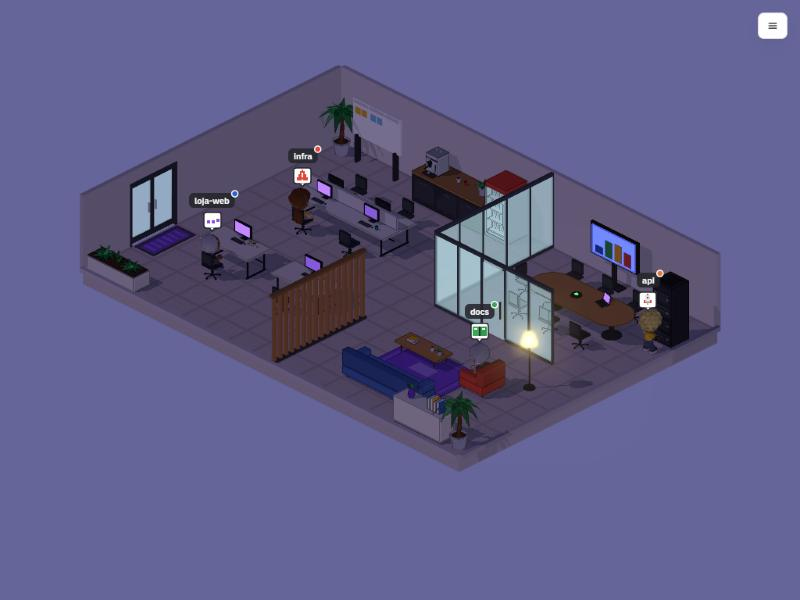

# Floorwalk

**Walk the floor and watch your AI agents work.** Every Claude Code session you run becomes a character in a 3D
office, and it goes to the furniture that matches what it is actually doing: the desk when it edits, the bookshelf
when it reads, the server rack when it pushes, and it raises a flag when it needs your permission.

[Português](README.pt-BR.md)



> Status: early open-source release. Works on Windows, macOS and Linux with Node 22.9+.
> The interface follows your browser language (English or Portuguese); switch it in the menu (☰ → Idioma / Language).

## Quick start (Claude Code, no API key)

```bash
git clone https://github.com/efesodavila/Floorwalk.git
cd Floorwalk
npm install
npm run hooks:install
npm start
```

Open http://127.0.0.1:8787 and start a Claude Code session in any project. It walks in through the door.
No API key and no setup screen: the office opens ready for Claude Code.

| Claude Code is… | in the office |
|-----------------|---------------|
| editing or writing files | works at a computer |
| reading, searching, browsing the web | goes to the bookshelf or armchair |
| running tests or lint | reviewing |
| `git push`, deploy, publish | goes to the server rack |
| planning or delegating to subagents | goes to the board (or the meeting table) |
| asking for permission | blocked, with an alert |
| waiting for your answer | waiting |
| done with its turn | celebrates |
| session closed | leaves the room |

Click a character to open its card: what it is doing right now, where, time spent per activity, and a timestamped
history of its actions. The history survives a page reload.

## What makes it different

- **Actions go to the right place.** The character does not just type or read; each kind of work has its own spot in
  the room, so you can tell at a glance who is shipping, who is stuck and who is researching.
- **It can also do the work.** Besides watching Claude Code, Floorwalk has its own AI team: describe your business,
  connect OpenAI, Anthropic or Ollama, and delegate tasks. A coordinator splits the work, people research, produce,
  review and deliver, and every result is saved as Markdown.
- **Build your own office.** Empty room, your layout: furniture, walls, glass rooms, people and roles, all in 3D.

## Safety and privacy

`npm run hooks:install` edits `~/.claude/settings.json`, which also holds your permissions, so it is careful:

- If the file is unreadable or has a shape it does not know, it stops and changes nothing.
- Before the first write it saves a copy (`settings.json.floorwalk.backup`) and never overwrites that copy.
- It only touches its own entries. Your hooks, and hooks from other tools, stay as they are.
- `npm run hooks:status` shows whether it is on; `npm run hooks:uninstall` removes only Floorwalk's entries.

The hook never gets in Claude Code's way: it prints nothing, always exits successfully and gives up in under a second
when the server is not running. Events only go to your own machine (`127.0.0.1`), authenticated with a secret stored
in `~/.floorwalk/hook.json`. Your prompts are not read. Commands are shown truncated, with anything that looks like a
token, key or password removed. Sessions are never saved into your office layout.

## The AI team (optional, off by default)

Menu (☰) → **Ligar a equipe de IA** turns it on; the same item turns it off again (your key and business stay saved).
When it is off there is no task field and no AI setup. When it is on, pick OpenAI, Anthropic or Ollama and paste your key. The server tests the models on your
account and picks one that answers (set `FLOORWALK_MODEL` in `.env` to force one). Then describe your business: the
AI creates the team, roles and labels, and you build the room. Type a task in the field at the bottom and watch the
team work.

- The key stays in `data/settings.json` on your machine; the page never receives it back. You can also use `.env`
  (see `.env.example`).
- **Web research:** during research the team can search (DuckDuckGo, or Brave Search with `BRAVE_API_KEY`), read up to
  4 pages and cite sources. Read-only: agents do not run code or submit forms, and local network addresses are blocked.
  Toggle it in the menu, or set `FLOORWALK_WEB=0`.
- **Parallel tasks:** up to 2 at a time (`FLOORWALK_PARALELO`), queue of 5.
- **Cost:** each task makes 3 to 8 model calls. Check usage on your provider's dashboard.
- `npm run demo` runs the same flow with simulated events, no key and no cost.

## Controls

Drag to pan, scroll to zoom toward the cursor, right-drag (or Shift + drag) to rotate in 90° steps; arrows/WASD also
pan. Click a person to open their card. Menu (top right) → edit the room.

Without WebGL the page falls back to a 2D view. `npm run build:single` creates a single offline HTML file
(`dist/floorwalk.html`, about 10 MB with the 3D models; `--sem-modelos` makes it about 1 MB).

## How it works

```
Claude Code ──hooks──▶ ┐
                       ├─▶ server (server/) ──events──▶ page (web/, Three.js)
your AI team ─────────▶ ┘
```

The server turns everything into events of the [Floorwalk protocol](docs/PROTOCOLO.md) over a WebSocket. Any agent
system can speak it: send `{ "agent": "Bia", "state": "trabalhando", "place": "computador" }` and the character walks
to a computer.

| folder | contents |
|--------|----------|
| `web/` | the page: `index.html`, `css/app.css`, `js/` (one file per topic), `js3d/` (3D scene, furniture, characters) |
| `server/` | HTTP + WebSocket server, Claude Code bridge, AI team, protocol |
| `scripts/` | hook script, hook installer, single-file build, checks |
| `test/` | `npm test` (no AI calls) |
| `docs/` | protocol and development notes (Portuguese) |

## Known limits

- The optional AI team screens (setup, business description, results) and the protocol's state names are still in Portuguese.
- Claude Code is the only coding agent supported today. Codex and Gemini CLI are next.
- Subagents do not get their own character yet; the main session goes to the meeting table when it delegates.
- One office per server. The AI team runs up to 2 tasks at once; quality depends on the model you connect.
- Web research is read-only, and DuckDuckGo may rate-limit automated searches.
- **3D character models** in `web/modelos/` were generated with [Meshy](https://www.meshy.ai) on a paid plan, which grants
  commercial-use rights, and are distributed with the project under the same MIT license. If you prefer not to use them,
  delete the folder and the code-built low-poly characters take over.

## Contributing

See [CONTRIBUTING.md](CONTRIBUTING.md). Development notes, decisions and the backlog live in
[`docs/CONTINUACAO.md`](docs/CONTINUACAO.md) (Portuguese).

## License

[MIT](LICENSE)
