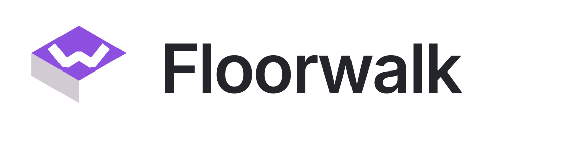
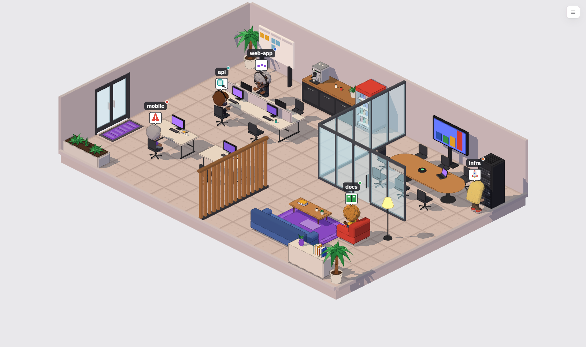
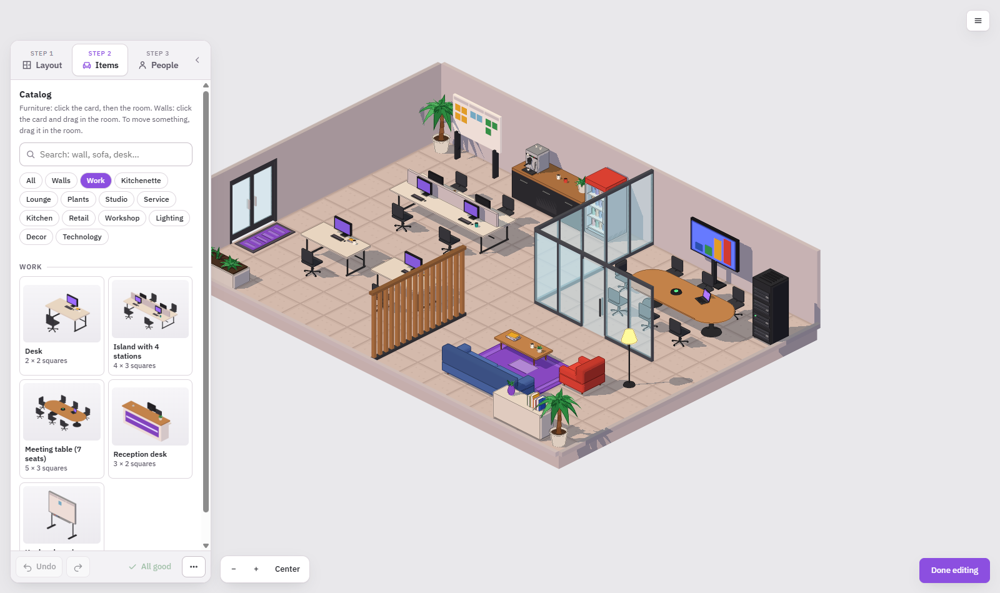
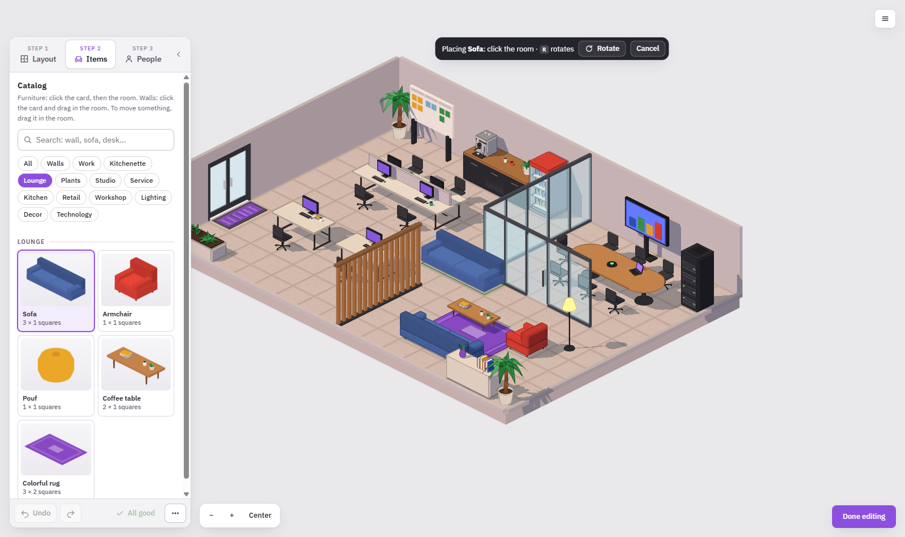
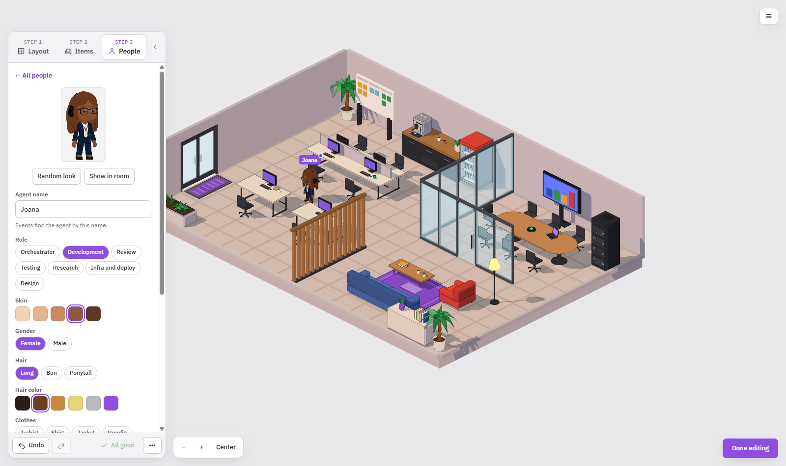
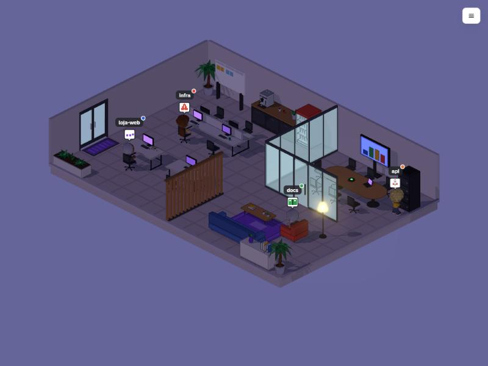

<h1 align="center">
  <picture>
    <source media="(prefers-color-scheme: dark)" srcset="docs/img/logo-dark.svg">
    
  </picture>
</h1>

**Ande pela sala e veja seus agentes de IA trabalhando.** Cada sessão do Claude Code que você roda vira um personagem
num escritório 3D e vai ao móvel que combina com o que ela está fazendo de verdade: a mesa quando edita, a estante
quando lê, o rack de servidores quando publica, e levanta um alerta quando precisa da sua permissão.

[English](README.md)



> Estado: primeira versão aberta. Funciona no Windows, macOS e Linux com Node 22.9 ou mais novo.
> A interface segue o idioma do navegador (inglês ou português); dá para trocar no menu (☰ → Language / Idioma).

## Começo rápido

```bash
git clone https://github.com/efesodavila/Floorwalk.git
cd Floorwalk
npm install
npm run hooks:install
npm start
```

Abra http://127.0.0.1:8787 e abra uma sessão do Claude Code em qualquer projeto. Ela entra pela porta.
Sem chave e sem tela de configuração: o escritório já abre pronto para o Claude Code.

| o Claude Code está… | na sala |
|---------------------|---------|
| editando ou criando arquivos | trabalha no computador |
| lendo, buscando, pesquisando na web | vai à estante ou à poltrona |
| rodando testes ou lint | revisando |
| fazendo `git push`, deploy ou publicação | vai ao rack de servidores |
| planejando ou delegando a subagentes | vai ao quadro (ou à mesa de reunião) |
| pedindo permissão | fica bloqueado, com alerta |
| esperando sua resposta | aguardando |
| terminou o turno | comemora |
| sessão encerrada | sai da sala |

Clique num personagem para abrir a ficha: o que está fazendo agora, onde, o tempo em cada atividade e o histórico das
ações com a hora. O histórico continua lá depois de recarregar a página.

## O que tem de diferente

- **Cada ação vai ao lugar certo.** O personagem não só digita ou lê: cada tipo de trabalho tem o seu canto na sala, e
  dá para ver de longe quem está publicando, quem travou e quem está pesquisando.
- **Nada para configurar.** Sem chave de API, sem conta, sem nuvem: o servidor roda no seu computador e só atende a ele.
- **O escritório é seu.** Sala vazia, montada por você: móveis, paredes, salas de vidro, pessoas e papéis, tudo em 3D.

## Monte o seu escritório

Menu (☰) → **Editar a sala e as pessoas**. Escolha os móveis no catálogo, solte no piso e ajuste as pessoas, se quiser
personagens fixos além das sessões.

| Escolher os móveis | Colocar na sala | Ajustar um personagem |
|---|---|---|
|  |  |  |

A iluminação acompanha a hora do dia (ou escolha dia, tarde ou noite no menu):



## Segurança e privacidade

`npm run hooks:install` mexe no `~/.claude/settings.json`, que também guarda as suas permissões, e por isso toma cuidado:

- Se o arquivo estiver ilegível ou num formato que ele não conhece, para e não muda nada.
- Antes da primeira escrita guarda uma cópia (`settings.json.floorwalk.backup`) e nunca sobrescreve essa cópia.
- Só mexe nas próprias entradas. Os seus hooks, e os de outras ferramentas, ficam como estão.
- `npm run hooks:status` mostra se está ligado; `npm run hooks:uninstall` tira só as entradas do Floorwalk.

O servidor só atende pedidos endereçados ao seu próprio computador (`localhost` ou um IP), o que impede outro site de se
passar por ele (DNS rebinding). Para acessar por um nome (proxy, Tailscale), liste o nome em `FLOORWALK_ALLOWED_HOSTS`.

O hook nunca atrapalha o Claude Code: não escreve nada, sempre sai com sucesso e desiste em menos de 1 segundo quando o
servidor está desligado. Os eventos só vão para o seu computador (`127.0.0.1`), com uma senha guardada em
`~/.floorwalk/hook.json`. Os seus pedidos não são lidos. Os comandos aparecem cortados e sem nada que pareça senha,
chave ou token. As sessões nunca entram no escritório salvo.

## Controles

Arrastar move a sala, a roda aproxima na direção do cursor, botão direito (ou Shift + arrastar) gira em passos de 90°;
setas/WASD também movem. Clique numa pessoa para abrir a ficha. Menu (canto superior direito) → editar a sala.

Sem WebGL a página volta para o desenho 2D. `npm run build:single` gera um único arquivo HTML que funciona sem
servidor (`dist/floorwalk.html`, cerca de 10 MB com os modelos 3D; `--sem-modelos` gera cerca de 1 MB).

## Como funciona

```
Claude Code ──hooks──▶ servidor (server/) ──eventos──▶ página (web/, Three.js)
```

O servidor transforma tudo em eventos do [protocolo Floorwalk](docs/PROTOCOLO.md) por WebSocket. Qualquer sistema de
agentes pode falar esse protocolo: mande `{ "agent": "Bia", "state": "trabalhando", "place": "computador" }` e o
personagem vai até um computador.

| pasta | o que tem |
|-------|-----------|
| `web/` | a página: `index.html`, `css/app.css`, `js/` (um arquivo por assunto), `js3d/` (cena 3D, móveis, personagens) |
| `server/` | servidor HTTP + WebSocket, ponte do Claude Code, protocolo |
| `scripts/` | script do hook, instalador dos hooks, arquivo único, conferências |
| `test/` | `npm test` |
| `docs/` | protocolo e notas de desenvolvimento |

## Limites conhecidos

- O Claude Code é o único agente de código suportado hoje. Codex e Gemini CLI vêm a seguir.
- Subagentes ainda não ganham personagem próprio; a sessão principal vai à mesa de reunião quando delega.
- Um escritório por servidor.
- **Modelos 3D dos personagens** em `web/modelos/` foram gerados no [Meshy](https://www.meshy.ai) num plano pago, que dá
  direito de uso comercial, e são distribuídos com o projeto sob a mesma licença MIT. Quem preferir não usá-los pode
  apagar a pasta: os personagens low-poly feitos em código assumem.

## Contribuir

Veja [CONTRIBUTING.md](CONTRIBUTING.md). Notas de desenvolvimento, decisões e pendências ficam em
[`docs/CONTINUACAO.md`](docs/CONTINUACAO.md).

## Licença

[MIT](LICENSE)
